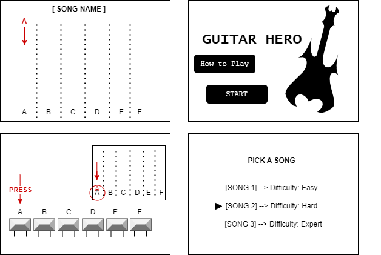

# 🎸 Guitar Hero — Embedded Rhythm Game

A **Guitar Hero-inspired rhythm game** built in **C++ with Mbed OS** for an **STM32 NUCLEO development board**. It brings music, visual note tracking, and physical controls together on a Nokia 5110 LCD.

## How to Play

1. Use the **joystick** to navigate the menu or open the animated **How to Play** tutorial.
2. Choose a song and difficulty:
   - **Easy:** *Twinkle Twinkle Little Star*
   - **Hard:** *Mr. Brightside*
   - **Expert:** *Wii Theme*
3. Watch the notes fall down the LCD and **press the matching physical button** at the right time.
4. Earn points for successful hits, receive sound and LED feedback, and see a performance rating when the song ends. Then **play again or exit**.

## Key Features

- **Custom pixel graphics** and an animated LCD tutorial.
- **Three playable songs** with different note sequences and difficulty levels.
- **Rhythm-based gameplay** with falling notes, timed button detection, and scoring.
- **Two PWM buzzers:** one plays the melody; the other provides feedback for successful notes.
- **LED indicators** linked to the notes, plus joystick-driven menus using a finite-state machine.

## Hardware & Technologies

**C++ · Mbed OS · STM32 NUCLEO-L476RG · Nokia 5110 LCD · Joystick · Six push buttons · LEDs · Two buzzers**

The project is designed to run on the development board with the connected components, rather than as a desktop game.

## Project Design

*Original LCD interface mockups created during development:*

[Gameplay flowchart](docs/flowchart.png) · [Initial class diagram](docs/ClassDiagram.png)
